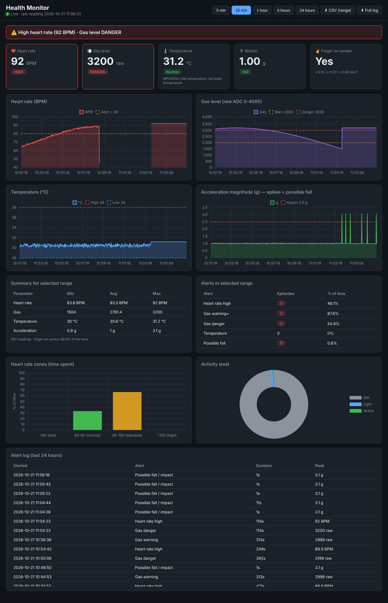

<h1 align="center">🦺 LifeLine — Smart Safety Jacket &amp; Edge AI Health Monitor</h1>

<p align="center">
  <b>End-to-End ESP32 + Raspberry Pi IoT Safety Wearable, Real-Time ML Risk Scoring, 100 Hz Fall Detection &amp; Live Flask Dashboard</b>
</p>

<p align="center">
  
  
  
  
  
</p>

<p align="center">
  
</p>

---

## 🌟 Overview

**LifeLine** is a multi-worker industrial safety & biometric monitoring platform built around an **ESP32-equipped Smart Safety Jacket** and a **Raspberry Pi Edge AI hub**. It combines deterministic **100 Hz IMU fall detection** on the wearable with real-time **MQTT telemetry**, **rolling-window machine learning risk classification**, **ThingSpeak cloud logging**, and a **Chart.js live monitoring web dashboard**.

---

## 🔄 System Architecture

```text
┌───────────────────────────┐     esp32/sensor_data (1 s)      ┌───────────────────────────────────────────┐
│   ESP32 Smart Jacket      │ ───────────────────────────────► │          Raspberry Pi Edge Hub            │
│                           │     esp32/fall_event (instant)   │                                           │
│ • MAX30102 Heart Rate     │ ───────────────────────────────► │  • processor.py ──► health_monitor_log.csv │
│ • MPU6050 6-Axis IMU      │                                  │                 ──► ThingSpeak (15 s)     │
│ • MQ Gas Sensor (GPIO 34) │     pi/risk/<WORKER_ID>          │  • live_inference.py (ML Risk + Man-Down) │
│ • WS2812B LED + Buzzer    │ ◄─────────────────────────────── │  • dashboard.py (Flask :5000)             │
└───────────────────────────┘     LOW / MEDIUM / HIGH / FALL   └───────────────────────────────────────────┘
```

---

## 📂 Repository Structure

| Module | Path | Description |
|---|---|---|
| **ESP32 Firmware** | [`iot_esp32/`](iot_esp32/) | Non-blocking Arduino/ESP32 sketch (`smart_jacket.ino`), 100 Hz [`FallDetector.h`](iot_esp32/smart_jacket/FallDetector.h), and standalone C++17 unit tests ([`test_fall_detector.cpp`](iot_esp32/tests/test_fall_detector.cpp)). |
| **Raspberry Pi Edge AI Hub** | [`iot_pi/`](iot_pi/) | Complete edge stack: MQTT ingest (`processor.py`), rolling 20 s ML feature extractor (`features.py`), risk classifier & anomaly detector (`predictor.py`, `live_inference.py`), multi-worker Flask dashboard (`dashboard.py`), training pipeline (`train_models.py`), and `systemd` services. |
| **Standalone Dashboard** | [`health-dashboard/`](health-dashboard/) | Lightweight drop-in Flask + offline Chart.js (`chart.umd.min.js`) web UI reading `health_monitor_log.csv` directly. |

---

## 🔧 Hardware & Pin Mapping (ESP32)

| Peripheral | Interface / Pin | Purpose |
|---|---|---|
| **MAX30102** | I2C (`SDA 21`, `SCL 22`) | Heart rate (`avg_bpm`) & finger-on-sensor detection |
| **MPU6050** | I2C (`SDA 21`, `SCL 22`) | 100 Hz 6-axis acceleration (`±16 g`), gyro, and chip temperature |
| **MQ Gas Sensor** | Analog (`GPIO 34`) | Ambient gas concentration monitoring (warn ≥ 2000, danger ≥ 3000) |
| **WS2812B RGB LED** | Digital (`GPIO 13`) | Visual ML risk status (`Green` LOW, `Yellow` MEDIUM, `Red` HIGH, `Fast Blink` FALL) |
| **Buzzer** | Digital (`GPIO 23`) | Audible alert on `HIGH` risk and `FALL` / `MAN DOWN` events |

---

## 🚀 Quick Start

### 1️⃣ ESP32 Smart Jacket Firmware
1. Open [`iot_esp32/smart_jacket/smart_jacket.ino`](iot_esp32/smart_jacket/smart_jacket.ino) in Arduino IDE (`ESP32 Dev Module`).
2. Configure `ssid`, `password`, `mqtt_server` (Pi IP), and `WORKER_ID` before flashing.
3. Run the C++17 fall-detector verification tests on PC:
   ```bash
   g++ -std=c++17 -o test_fd iot_esp32/tests/test_fall_detector.cpp && ./test_fd
   ```

### 2️⃣ Raspberry Pi Edge AI & Live Dashboard
```bash
cd iot_pi
bash install.sh       # Installs apt packages, Mosquitto MQTT broker & checks/trains ML models
bash run_all.sh       # Starts processor.py, live_inference.py, and dashboard.py (:5000)
```
Optional: run as background boot services with `bash install_services.sh`.

To export ThingSpeak / MQTT secrets safely:
```bash
export THINGSPEAK_API_KEY="your_write_api_key"
export MQTT_PASSWORD="your_mqtt_password"
```

---

## 👤 Authors, Collaborators & License

- **Creator & Lead Engineer**: **Dhayananth J ([`@0-Name-Alex`](https://github.com/0-Name-Alex))** • [dhayananth.me](https://dhayananth.me)
- **Collaborators**: **Devarasetty Kuldeep ([`@DevarasettyKuldeep`](https://github.com/DevarasettyKuldeep))** · **[`@Anbu-KK`](https://github.com/Anbu-KK)**

Licensed under the [MIT License](LICENSE).
